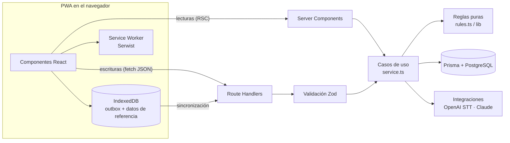
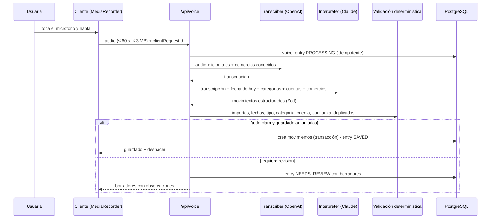

# Arquitectura

## 1. Resumen

Monolito modular en Next.js (App Router) desplegable en Vercel, con PostgreSQL administrado.
Sin backend separado ni microservicios: las páginas son Server Components que leen a través de
servicios, y las escrituras pasan por Route Handlers que validan con Zod y delegan en los mismos
servicios. Las reglas financieras son funciones puras, deterministas y probadas.



## 2. Stack (versiones verificadas el 2026-11-04)

| Área | Elección | Versión | Nota |
|---|---|---|---|
| Framework | Next.js (App Router, Turbopack) | 16.4.5 | Cache Components + Partial Prefetching activados |
| UI | React | 19.3.1 | |
| Lenguaje | TypeScript estricto | 6.0.3 | TS 7 (port nativo) no es compatible aún con `typescript-eslint` (`<6.1`) |
| Estilos | Tailwind CSS (`@tailwindcss/turbopack`) | 4.3.4 | |
| Componentes | shadcn/ui sobre Base UI | CLI 4.23 · `@base-ui/react` 1.9 | Preset por defecto de shadcn v4 |
| Íconos | Lucide React | 1.68.0 | |
| Formularios | React Hook Form + resolvers | 7.91.0 · 7.0.2 | |
| Validación | Zod | 4.6.7 | Compartido cliente/servidor |
| Gráficos | Recharts | 3.10.1 | |
| ORM | Prisma ORM + `@prisma/adapter-pg` | 7.10.1 | La etiqueta `latest` del CLI apunta a 8.0 RC; se fija la estable |
| Base de datos | PostgreSQL | 18 (local) | Cualquier ≥ 15 administrado |
| PWA | Serwist (modo configurador) | 9.5.13 | Compatible con Turbopack y Cache Components |
| Offline | IndexedDB vía `idb` | 8.0.4 | |
| Transcripción | OpenAI `gpt-transcribe` | API REST | Modelo recomendado vigente; los `gpt-4o-*-transcribe` están deprecados |
| Interpretación | Claude vía `@anthropic-ai/sdk` | 1.5.0 | Salida estructurada con Zod |
| Unit/integración | Vitest + Testing Library | 5.1.0 · 16.3.3 | jsdom 27 (compatible con Node 22.12+) |
| E2E | Playwright | 1.64.1 | |
| Lint | ESLint 9 + `eslint-config-next` | 9.x · 16.4.5 | Los plugins de React/a11y aún no soportan ESLint 10 |
| Base local | `embedded-postgres` | 18.6.0-beta.19 | Binarios oficiales de PostgreSQL, sin Docker |

Node.js ≥ 22.12 (Vitest 5 y Prisma 7 lo exigen).

## 3. Estructura

```
prisma/                     esquema y migraciones
scripts/                    base local, alta de usuaria, íconos
src/
  app/                      rutas: páginas, layouts y Route Handlers (presentación + HTTP)
    (app)/                  área autenticada con la navegación
    api/                    Route Handlers
  components/ui/            primitivas shadcn/ui
  components/               componentes compartidos de presentación
  lib/                      núcleo compartido e isomórfico: dinero, fechas, utilidades
  modules/<dominio>/        un módulo por dominio:
    schema.ts               validación Zod (cliente y servidor)
    rules.ts                reglas de negocio puras
    service.ts              casos de uso con persistencia (solo servidor)
    components/             UI del dominio
    providers/              integraciones externas (voz)
  server/                   infraestructura de servidor: Prisma, env, sesión, HTTP, auditoría
  generated/prisma/         cliente Prisma generado (no versionado)
tests/
  integration/              servicios contra PostgreSQL real
  e2e/                      Playwright
```

Dominios: `accounts`, `cards`, `categories`, `merchants`, `transactions`, `recurring`, `savings`,
`reports`, `voice`, `offline`, `auth`, `onboarding`, `settings`.

### Reglas de dependencia

- `rules.ts` y `lib/` no importan React, Next ni Prisma: son puros y se prueban sin infraestructura.
- `service.ts` importa `server-only`; es el **único** lugar que usa Prisma.
- Los componentes nunca importan Prisma ni servicios; los Server Components de `app/` llaman servicios.
- Los Route Handlers solo traducen HTTP ↔ servicio: parsean, validan con el `schema.ts` del módulo,
  llaman al servicio y serializan.
- Los proveedores externos se usan detrás de interfaces (`Transcriber`, `TransactionInterpreter`) que
  el servicio de voz recibe; las pruebas usan implementaciones falsas.

## 4. Flujo de datos

**Lectura.** Cada página es un shell estático (encabezado, navegación, esqueletos) y el contenido
dependiente de la sesión se renderiza dentro de `<Suspense>`: el componente asíncrono llama a
`requireUser()` (lee la cookie, valida la sesión, memoizado por request) y luego al servicio. Esto es
lo que exige Cache Components y permite que el shell se sirva al instante.

La navegación (barra inferior y lateral) también va dentro de `<Suspense>`: la ruta actual es un dato
de request y, en rutas con parámetros, leerla fuera de un límite bloquea el prerender. El fallback es
la misma barra sin el ítem activo.

**Escritura.** Los formularios (React Hook Form + Zod) hacen `fetch` a `/api/...`. El handler
(`route()` en `src/server/http.ts`) verifica sesión, origen, rate limit y tamaño; valida el cuerpo;
ejecuta el caso de uso; y responde JSON. La UI luego llama a `router.refresh()`.

Las escrituras de varias filas (compra en cuotas, confirmación de voz, configuración inicial,
generación de recurrentes, reasignación de categorías) usan transacciones de PostgreSQL
(`prisma.$transaction`).

## 5. Dinero y fechas

- `NUMERIC(14,2)` ↔ string decimal en la API ↔ `bigint` en centavos en TypeScript (`src/lib/money.ts`).
- Las fechas contables son `DATE` y viajan como `YYYY-MM-DD`; "hoy" se calcula en
  `America/Argentina/Cordoba` (`src/lib/dates.ts`) tanto en el servidor como en el cliente.
- Los meses viajan como `YYYY-MM`.

## 6. Autenticación y sesiones

- Contraseña con **scrypt** (`node:crypto`, N=2¹⁷, r=8, p=1, sal de 16 bytes): parámetros OWASP sin
  dependencias nativas.
- Sesión: token aleatorio de 256 bits en cookie `HttpOnly`, `Secure`, `SameSite=Lax` (`__Host-` en
  producción). En la base solo se guarda su SHA-256. Vence a los 60 días, con renovación deslizante.
- `proxy.ts` hace un chequeo optimista (¿hay cookie?) para redirigir a `/login`; la verificación real
  ocurre en la capa de datos (`requireUser`) en cada página y handler, como recomienda Next.js.
- Sin registro público: la cuenta se crea con `npm run user:create`.
- Login con rate limit por IP y por email; los intentos fallidos se auditan.

## 7. Validación y errores

- Zod valida en el cliente (feedback inmediato) y en el servidor (autoridad).
- Errores de dominio: `AppError` con `code`, `status` y mensaje en español apto para mostrar.
- `route()` traduce `AppError`, `ZodError` (422 con errores por campo) y errores conocidos de Prisma
  (P2002 → 409, P2025 → 404) a un formato único:

```json
{ "error": { "code": "VALIDATION_ERROR", "message": "Revisá los datos.", "fields": { "amount": "Ingresá un importe mayor a cero." } } }
```

- Los errores inesperados se registran sin datos financieros (código, ruta, id de usuaria) y
  responden 500 con un mensaje genérico.

## 8. Voz



- **Grabación:** `MediaRecorder` con el primer formato soportado (`audio/webm;codecs=opus` en
  Chrome/Android, `audio/mp4` en Safari/iOS). Corte automático a los 60 s.
- **Transcripción:** `POST https://api.openai.com/v1/audio/transcriptions` con `model=gpt-transcribe`,
  `languages[]=es`, `keywords[]` (comercios más usados) y un `prompt` de contexto. Se llama con
  `fetch` + `FormData`: el SDK oficial declara como dependencias obligatorias clientes de AWS y Google
  que no se usan.
- **Interpretación:** `client.beta.messages.parse` del SDK de Anthropic con `betaZodOutputFormat`,
  `output_config.effort = "low"` (extracción simple, latencia baja) y `fallbacks: "default"` (beta
  `server-side-fallback-2026-07-01`) para que un rechazo falso positivo del clasificador no deje la
  función caída. El modelo es configurable (`ANTHROPIC_MODEL`, por defecto `claude-opus-5-5`;
  `claude-haiku-5-5` reduce costo y latencia).
- **Respaldo:** sin `ANTHROPIC_API_KEY`, un intérprete local por reglas (números en español, fechas
  relativas, verbos de ingreso/gasto, comercios conocidos) produce borradores que siempre requieren
  revisión. El analizador de números en español también valida los importes del modelo.
- **Privacidad:** el audio se procesa en memoria y no se persiste. Las claves de API solo existen en
  el servidor.

## 9. PWA y funcionamiento sin conexión

- **Manifest** (`app/manifest.ts`), íconos 192/512/maskable, `apple-touch-icon`, `viewport-fit=cover`
  y safe areas.
- **Service worker** con Serwist en **modo configurador**: `serwist build` corre después de
  `next build` y genera `public/sw.js` con el precache de `/_next/static`. Se eligió este modo porque
  la integración por Route Handler (`@serwist/turbopack`) exporta `dynamic = "force-static"`,
  incompatible con Cache Components.
- **Caché en tiempo de ejecución:** navegaciones `NetworkFirst` (si no hay red se sirve la última
  versión vista o `/~offline`); estáticos con caché; **`/api/*` siempre por red** (los datos offline
  vienen de IndexedDB, no del caché HTTP). No se precachean los shells prerenderizados: con PPR el
  contenido dinámico llega en la misma respuesta y un shell en caché quedaría vacío.
- **Outbox en IndexedDB:** si un alta falla por falta de red, se encola con su `clientId`. La
  sincronización corre al recuperar la conexión, al volver la app a primer plano y al abrirla; procesa
  la cola en orden y reintenta con espera exponencial. Una sola ejecución a la vez (Web Locks entre
  pestañas).
- **Alcance offline:** sin conexión se pueden **crear** movimientos. Editar o borrar movimientos ya
  sincronizados requiere conexión: así el único conflicto posible de una operación encolada es que el
  servidor la rechace (por ejemplo, una categoría borrada mientras tanto), y la UI ofrece reintentar o
  descartar. Las ediciones en línea sí usan control de versión (`VERSION_CONFLICT` devuelve la versión
  actual).
- **Limitaciones de iOS:** Safari no implementa Background Sync, por eso no hay sincronización con la
  app cerrada: ocurre cuando la app vuelve a estar activa con conexión. La voz no funciona sin
  conexión y la UI lo indica.
- Al cerrar sesión se borran los cachés y la base local.

## 10. Seguridad

- Headers (`next.config.ts`): CSP, `X-Content-Type-Options`, `Referrer-Policy`,
  `Permissions-Policy` (micrófono solo propio), `Strict-Transport-Security`, `X-Frame-Options`,
  `Cross-Origin-Opener-Policy`.
- **CSP sin nonce:** el prerender parcial (PPR) es incompatible con nonces, así que `script-src`
  permite `'unsafe-inline'` y todo lo demás está restringido (`default-src 'self'`,
  `connect-src 'self'`, `frame-ancestors 'none'`, `object-src 'none'`, `base-uri 'self'`). La app no
  renderiza HTML de terceros ni usa scripts externos.
- Mutaciones: verificación de `Origin`/`Sec-Fetch-Site` además de `SameSite=Lax`.
- Rate limiting en PostgreSQL (ventana fija, atómico con `INSERT … ON CONFLICT`): login, voz y
  escrituras.
- Audio: tipos MIME permitidos, máximo 3 MB y 60 s; nunca se escribe a disco.
- Todas las consultas filtran por `user_id` de la sesión (sin IDOR); los ids que llegan del cliente se
  verifican como propios.
- Logs sin importes, descripciones ni transcripciones.

## 11. Pruebas

| Nivel | Herramienta | Alcance |
|---|---|---|
| Unitarias | Vitest | `lib/` y `rules.ts`: dinero, fechas, efectos, tarjetas, cuotas, recurrencias, proyección, números en español, intérprete local, validación de voz |
| Componentes | Vitest + Testing Library (jsdom) | input de importe, formulario de movimiento, estados de voz, outbox |
| Integración | Vitest + PostgreSQL embebido | servicios contra una base real con migraciones; los 18 casos financieros obligatorios |
| E2E | Playwright (Chromium, viewport iPhone) | login, configuración inicial, alta manual, tarjeta y pago, voz (proveedor falso), offline y sincronización |

## 12. Despliegue

- Vercel con PostgreSQL administrado (Neon, Supabase, Prisma Postgres u otro). Nada del código depende
  del proveedor: solo `DATABASE_URL` (conexión directa o con pooler compatible con `pg`).
- Build: `prisma generate && next build && serwist build`. Migraciones con `npm run db:deploy`.
- Cron diario (Vercel Cron → `/api/cron/daily` con `CRON_SECRET`): recurrentes y limpieza. La app
  también genera recurrentes al abrirse, así que el cron es opcional.

Variables de entorno: ver `.env.example`.

## 13. Contratos de API

Convenciones: JSON; dinero como string decimal (`"69500.00"`); fechas `YYYY-MM-DD`; meses
`YYYY-MM`; autenticación por cookie de sesión; errores con el formato de §7.

| Método y ruta | Cuerpo / query | Respuesta |
|---|---|---|
| `POST /api/auth/login` | `{ email, password }` | `200 { user }` + cookie · 401 · 429 |
| `POST /api/auth/logout` | — | `204` |
| `GET /api/bootstrap` | — | `{ user, accounts, categories, merchants }` (datos de referencia para la UI y el modo offline) |
| `POST /api/onboarding` | fecha de inicio, cuentas, tarjetas, cuenta habitual | `201` |
| `GET/POST /api/accounts` | alta: `{ name, type, institution?, openingBalance, openingDate }` | lista con saldos / `201 { account }` |
| `PATCH/DELETE /api/accounts/:id` | campos editables | `200` / `204` · `409 ACCOUNT_IN_USE` |
| `POST /api/accounts/:id/adjust` | `{ actualBalance }` | `201 { transaction }` o `200 { transaction: null }` |
| `POST /api/cards` | configuración y deuda inicial | `201` |
| `PATCH /api/cards/:id` | campos editables | `200` |
| `GET /api/cards/:id/status` | — | a pagar, próximo resumen, cuotas futuras, deuda, historial |
| `PUT/DELETE /api/cards/:id/cycles/:period` | `{ closingDate, dueDate }` | `200` / `204` |
| `GET/POST /api/categories`, `PATCH /api/categories/:id` | | |
| `DELETE /api/categories/:id?reassignTo=` | | `204` · `409 CATEGORY_IN_USE` |
| `GET/POST /api/merchants`, `PATCH/DELETE /api/merchants/:id` | | |
| `GET /api/transactions` | `from, to, type, categoryId, accountId, paymentMethod, merchantId, status, q, cursor` | `{ items, nextCursor }` |
| `POST /api/transactions` | `{ clientId, type, amount, date, accountId, toAccountId?, categoryId?, merchantName?, paymentMethod?, isFixed?, description?, notes?, installments? }` | `201` nuevo · `200` si el `clientId` ya existía |
| `GET/PATCH/DELETE /api/transactions/:id` | edición con `version` | `200` · `409 VERSION_CONFLICT { current }` |
| `POST /api/transactions/:id/confirm` | `{ version, amount? }` | `200` |
| `GET/POST /api/recurring`, `PATCH/DELETE /api/recurring/:id` | | |
| `POST /api/recurring/run` | — | `{ created }` |
| `GET /api/savings` | — | resumen y objetivos |
| `POST /api/savings/goals`, `PATCH/DELETE /api/savings/goals/:id` | | |
| `POST /api/savings/goals/:id/allocations` | `{ amount, note? }` (negativo libera) | `201` · `409 INSUFFICIENT_FREE_BALANCE` |
| `GET /api/dashboard?month=` | | métricas del mes |
| `POST /api/voice` | multipart: `audio`, `clientRequestId`, `durationMs` | `{ entry }` |
| `POST /api/voice/text` | `{ clientRequestId, text }` | `{ entry }` |
| `GET /api/voice/:id` | | `{ entry }` |
| `POST /api/voice/:id/confirm` | `{ items[] }` | `{ entry, transactions }` |
| `POST /api/voice/:id/undo`, `/discard` | | `{ entry }` |
| `PATCH /api/settings` | `{ name?, defaultAccountId?, voiceAutoSave? }` | `200` |
| `POST /api/settings/password` | `{ currentPassword, newPassword }` | `204` |
| `GET /api/cron/daily` | `Authorization: Bearer $CRON_SECRET` | `{ users, created }` |
| `GET /api/health` | — | `{ ok, db }` |

## 14. Registro de decisiones

| # | Decisión | Alternativas descartadas | Motivo |
|---|---|---|---|
| 1 | Monolito modular Next.js | Backend Express, microservicios | Una usuaria, un despliegue; los Route Handlers bastan |
| 2 | Sin capa de repositorios | Repositorios sobre Prisma | Prisma ya es la capa de datos; los servicios son el único punto de acceso |
| 3 | Saldos derivados | Saldos guardados y actualizados | Consistencia por construcción al editar/borrar |
| 4 | Cuentas y tarjetas en una tabla | Tablas separadas con FKs paralelas | Un movimiento siempre tiene `account_id` (+ `to_account_id`); la tarjeta es un pasivo más |
| 5 | Dinero en `NUMERIC` + `bigint` | `float`, `decimal.js` en el cliente | Exacto, sin dependencias en el cliente |
| 6 | Cache Components activado | Desactivarlo | Es el modelo por defecto de Next 16.4 y será obligatorio en la próxima versión mayor |
| 7 | Serwist en modo configurador | `@serwist/turbopack` | Este último usa `dynamic = "force-static"`, incompatible con Cache Components |
| 8 | CSP sin nonce | Nonce por request | PPR no admite nonces |
| 9 | Sesiones propias + scrypt | Auth.js, Better Auth | Una usuaria, sin OAuth: menos superficie y cero dependencias |
| 10 | Rate limit en PostgreSQL | Memoria, Redis/Upstash | Funciona entre instancias serverless sin otro proveedor |
| 11 | Transcripción con OpenAI `gpt-transcribe` vía `fetch` | SDK `openai` | El SDK instala ~120 paquetes (AWS, Google) como dependencias obligatorias |
| 12 | Interpretación con Claude + validación determinística + intérprete local | Solo LLM | No se confía ciegamente en el modelo; la app sigue funcionando sin la clave |
| 13 | Sin `MonthlySnapshot` | Tabla de snapshots | Los informes se derivan de movimientos; un snapshot se desactualiza |
| 14 | PostgreSQL embebido para desarrollo y pruebas | Docker, instalación del sistema | Funciona sin privilegios de administrador ni Docker |
