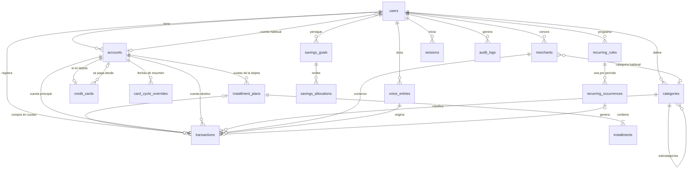

# Modelo de datos

Fuente de verdad: [`prisma/schema.prisma`](../prisma/schema.prisma) y las migraciones en
[`prisma/migrations`](../prisma/migrations). Motor: PostgreSQL ≥ 15 (desarrollo con PostgreSQL 18).

## Convenciones

| Aspecto | Decisión | Motivo |
|---|---|---|
| Claves primarias | UUID v7 generados por Prisma | Ordenables por tiempo (índices compactos) y seguros para generar en el cliente |
| Nombres | Tablas en plural y columnas en `snake_case` (`@@map`/`@map`) | SQL legible para consultas de informes |
| Dinero | `NUMERIC(14,2)` | Exacto; ver BUSINESS_RULES §1 |
| Fechas contables | `DATE` | Un gasto ocurre en un día, no en un instante: evita errores de zona horaria |
| Instantes | `TIMESTAMPTZ(3)` | Auditoría, sesiones, orden de carga |
| Multiusuario | `user_id` en toda entidad de negocio | Preparado para más usuarios; todas las consultas filtran por usuaria |
| Borrado | Físico, con restricciones de integridad | Ver "Soft delete" más abajo |

## Diagrama entidad-relación



## Tablas

### `users`
Usuaria, credenciales (hash scrypt) y preferencias: zona horaria, moneda, fecha de inicio del registro,
cuenta habitual y guardado automático por voz.

### `accounts` y `credit_cards`
Toda cuenta —de activo o tarjeta— vive en `accounts`. Las tarjetas (`type = CREDIT_CARD`) tienen una fila
1:1 en `credit_cards` con límite, días de cierre y vencimiento, cuenta de pago y la composición de la
deuda inicial (`opening_statement_balance`, `opening_unbilled_balance`). Unificar cuentas y tarjetas
permite que un movimiento tenga siempre `account_id` (+ `to_account_id`) sin columnas paralelas.

`card_cycle_overrides` guarda las fechas reales de un resumen cuando el banco las mueve.

### `transactions`
Movimientos. Columnas clave: `type`, `status`, `source`, `date`, `amount`, `account_id`,
`to_account_id`, `category_id`, `merchant_id`, `payment_method`, `is_fixed`, `client_id` (idempotencia),
`version` (concurrencia optimista), `voice_entry_id` (origen).

### `installment_plans` e `installments`
Planes de cuotas de una tarjeta. Con `transaction_id`: compra registrada (el gasto es la transacción).
Sin él: cuotas pendientes de compras anteriores al inicio (deuda inicial). Cada cuota tiene número e
importe; su período se deriva de `first_period` y `first_installment_number`.

### `categories` y `merchants`
Categorías de gasto o ingreso con un nivel de subcategorías, ícono, color y "fijo por defecto".
Comercios con nombre normalizado único, variantes para la voz y categoría habitual.

### `recurring_rules` y `recurring_occurrences`
Reglas de recurrencia y su registro de idempotencia: una fila por `(rule_id, period_key)`. La fila
sobrevive al borrado del movimiento generado (queda `SKIPPED`).

### `savings_goals` y `savings_allocations`
Objetivos y asignaciones con signo (asignar/liberar). No se relacionan con cuentas ni movimientos: son
una clasificación interna del patrimonio.

### `voice_entries`
Cargas por voz o texto: estado, transcripción, modelos usados, borradores validados (`items`, JSON) y
duración/tamaño del audio. El audio no se guarda.

### `sessions`, `rate_limit_buckets`, `audit_logs`
Sesiones (el id es el SHA-256 del token), contadores de rate limiting por ventana fija (funcionan entre
instancias serverless) y bitácora de acciones relevantes.

## Restricciones

### Claves foráneas (ON DELETE)

| Relación | Acción | Motivo |
|---|---|---|
| `transactions.account_id`, `to_account_id` → `accounts` | RESTRICT | Una cuenta con movimientos se desactiva, no se borra |
| `transactions.category_id` → `categories` | RESTRICT | Borrar una categoría usada exige reasignar |
| `transactions.merchant_id` → `merchants` | SET NULL | El comercio es descriptivo |
| `installment_plans.transaction_id` → `transactions` | CASCADE | Borrar la compra borra sus cuotas |
| `recurring_occurrences.transaction_id` → `transactions` | SET NULL | La ocurrencia persiste para no regenerar |
| `categories.parent_id` → `categories` | RESTRICT | No quedan subcategorías huérfanas |
| Todo lo de una usuaria → `users` | CASCADE | Baja completa de una usuaria |

### Únicos

- `users.email`; `accounts (user_id, name)`; `merchants (user_id, normalized_name)`.
- `transactions (user_id, client_id)`: idempotencia de altas offline y reintentos.
- `voice_entries (user_id, client_request_id)`: reintentos de subida de audio.
- `recurring_occurrences (rule_id, period_key)`: una ocurrencia por período.
- `installments (plan_id, number)`, `card_cycle_overrides (card_account_id, period)`.
- `installment_plans.transaction_id`, `recurring_occurrences.transaction_id`.

### CHECK (migración `init`)

| Tabla | Regla |
|---|---|
| `transactions` | importe > 0, salvo ajustes (≠ 0) |
| `transactions` | `to_account_id` presente solo en transferencias y pagos de tarjeta, y distinto de `account_id` |
| `transactions` | categoría presente solo en ingresos y gastos |
| `transactions` | descripción no vacía |
| `accounts` | una tarjeta tiene `opening_balance = 0` |
| `credit_cards` | días entre 1 y 31; límite > 0; componentes de deuda inicial ≥ 0 |
| `card_cycle_overrides` | período `YYYY-MM`, cierre dentro de ese mes, vencimiento posterior al cierre |
| `installment_plans` | 1 a 72 cuotas, primera cuota registrada dentro del plan |
| `installments` | importe > 0 |
| `recurring_rules` | solo ingresos o gastos; importe > 0; intervalo 1–366; fin ≥ inicio |
| `savings_goals` / `savings_allocations` | objetivo > 0 / asignación ≠ 0 |

Las reglas que cruzan tablas (por ejemplo, que el destino de un pago sea una tarjeta) se validan en
los servicios, que son el único punto de escritura.

## Índices

- `transactions (user_id, date DESC)`: lista de movimientos y rangos de informes.
- `transactions (account_id, date)` y `(to_account_id, date)`: saldos por cuenta.
- `transactions (user_id, status)`, `(category_id)`, `(merchant_id)`, `(voice_entry_id)`: filtros.
- `accounts (user_id, type)`, `categories (user_id, kind)`, `recurring_rules (user_id, is_active)`.
- `sessions (expires_at)` y `rate_limit_buckets (window_start)`: limpieza.

## Qué no se guarda y por qué

- **Saldos:** se derivan de saldos iniciales + movimientos confirmados. Guardarlos duplicaría la verdad
  y abriría la puerta a inconsistencias al editar o borrar.
- **`MonthlySnapshot`:** no se implementa. Los informes se calculan con agregaciones SQL sobre
  `transactions` (un mes típico tiene cientos de filas, no millones). Un snapshot quedaría desactualizado
  al editar un movimiento antiguo. Si el volumen creciera, la alternativa es una vista materializada
  refrescada en cada escritura, no una tabla mantenida a mano.
- **Audio de voz:** se procesa en memoria y se descarta.

## Soft delete

No se usa. Las entidades que no deben desaparecer con historia (cuentas, tarjetas) se **desactivan**
(`is_active`); los objetivos de ahorro se **archivan** (`archived_at`). Los movimientos se borran
físicamente: el borrado es una acción explícita y queda en `audit_logs`.

## Migraciones

```bash
npm run db:migrate        # desarrollo: crea y aplica migraciones (prisma migrate dev)
npm run db:deploy         # producción/CI: aplica migraciones pendientes (prisma migrate deploy)
```

Para agregar restricciones que Prisma no expresa: `npx prisma migrate dev --create-only --name x`,
editar el SQL y aplicar con `npm run db:migrate`. Prisma no detecta los `CHECK` como divergencia del
esquema (verificado).
